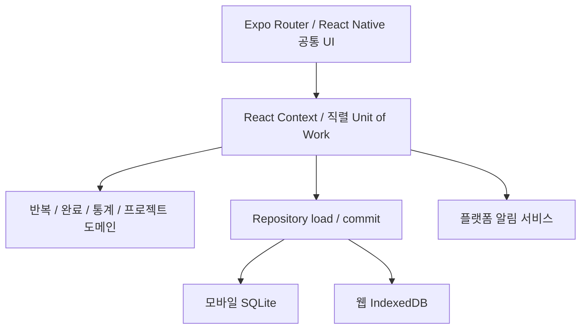

# 설계 결정

## 경계

화면은 불변 상태 복제본에 적용할 도메인 명령을 Context로 전달한다. Context는 명령을 순서대로 실행하고 DB commit 성공 뒤에만 UI를 갱신한다. 실패 시 이전 상태를 유지하고 입력 모달을 열어 둔다. UI와 DB 양쪽에서 중복 완료를 방지한다. 알림은 데이터 commit 이후 별도로 갱신하며 알림 실패로 저장을 되돌리지 않는다. 알림과 DB 사이에는 분산 트랜잭션이 없으므로 재실행 시 알림을 복구한다.

## 데이터 관계

- Routine 1:N PlannedOccurrence, Routine 1:N CompletionLog.
- PlannedOccurrence 0:1 활성 CompletionLog. 완료 취소 로그는 deletedAt으로 보존한다.
- Project 1:N ProjectMilestone.
- UUID, createdAt, updatedAt, deletedAt을 공통으로 관리한다. 예정 항목은 UUID와 별도로 routineId + localDate 키를 계산해 멱등성을 보장한다.
- SQLite는 부모 외래 키와 routine_id + scheduled_at unique, 활성 로그의 occurrence_id partial unique, 실행 시각 및 마일스톤 순서 인덱스를 정의한다.
- IndexedDB는 같은 형식의 엔티티를 각 스토어에 보관하고 루틴/일정 시각 복합 unique 인덱스 및 기록 시각·마일스톤 프로젝트 인덱스를 정의한다. 도메인에서 활성 로그 중복을 방지한다.
- 일정 수정으로 제거하는 미완료 예정 항목을 참조하는 취소 로그는 예정 연결만 null로 바꾼다. 로그 본문과 routineId는 보존하며 외래 키 고아를 방지한다.

## 반복과 시간

날짜 규칙은 `YYYY-MM-DD`, 현지 시각은 `HH:mm`, 실행·예약 시점은 ISO UTC로 저장한다. `new Date(local date + local time)`으로 각 날짜의 현지 시점을 계산하므로 DST 전후에도 24시간 단위 밀리초 덧셈을 하지 않는다. 현지에 존재하지 않는 DST 시각에 대한 완료 입력은 거부한다. 루틴의 DST 결손 시각은 JavaScript Date의 다음 유효 시각으로 정규화된다. DST 중복 시각은 Date의 기본 해석(첫 번째 시점)을 따른다.

생성은 시작일부터 오늘+30일까지 수행하고 generatedThrough를 저장한다. 이후에는 부족한 구간만 보충한다. 장기간 미실행 시 과거의 누락 구간도 보충한다. 과거 데이터는 유한한 실제 기간만큼 증가한다. 최초 등록 시 아주 오래된 시작일을 입력하면 많은 항목이 생성될 수 있다.

기기 IANA 시간대 변경 시 미래 미완료 예정만 새 현지 시각으로 생성한다. 과거/완료/건너뜀은 보존한다. 주당 목표는 일정으로 생성하지 않는다. 완료 기록을 주 단위로 집계해 목표와 비교하며 빠른 연속 탭은 1.5초 동안 중복 수동 기록을 억제한다. 사용자가 취소한 실행은 즉시 다시 완료할 수 있다.

일정 수정은 오늘을 포함한 미래 미완료 예정만 재생성한다. 비활성화 기간에 일정은 생성하지 않으며 재개 전의 이미 존재하는 과거 기록은 유지한다. 보관은 비활성+논리 삭제이다. 완료된 과거 기록을 수정하거나 취소할 수 있다.

주 시작일은 `weekStart(date, firstDay)` 경계에서 변경 가능하며 현재 UI는 월요일을 사용한다. 통계의 월/연/주 필터는 완료 시점의 기기 현지 날짜를 사용한다. 해외 이동 후 기록의 현지 표시일은 현재 기기 시간대에 맞춰 달라질 수 있다.

## 통계 정의

- 주간 목표: 이번 주 예정 항목 수 + 현재 활성 주 N회 루틴 목표. 주간 완료는 실제 완료 시각이 이번 주인 활성 로그 수.
- 오늘 실행률: 오늘 완료 예정 / 오늘 전체 예정. 건너뜀도 분모에 포함한다. 주 N회 자유 실행은 별도 목표 카드에 표시한다.
- 일간/요일 지정 활동 완료율: 오늘까지 예정 중 완료한 비율. 미래 예정은 제외한다.
- 주 N회 활동 완료율: 이번 주 실제 완료 / 목표. 초과 달성은 100%를 넘을 수 있다.
- 월간/연간/누적 시간/추이: deletedAt 없는 실제 완료 로그만 사용한다.
- 프로젝트 소요 기간: 시작 현지 날짜부터 완료 현지 날짜까지 양 끝을 포함한 날짜 수. 같은 날은 1일이다.

## 저장과 확장

스키마 버전은 1이다. 알 수 없는 저장 버전은 덮어쓰지 않고 초기화를 중단한다. 첫 배포이므로 과거 출시 스키마에 대한 마이그레이션은 없다. 이후 SQLite는 트랜잭션 마이그레이션, IndexedDB는 version upgrade를 단계별로 추가하고 실패 시 원본을 보존해야 한다.

MVP Repository는 전체 상태를 하나의 Unit of Work로 교체한다. 소규모 개인 데이터의 연관 변경을 쉽게 원자화하지만 대량 기록에는 비효율적이다. 이후 엔티티 Repository와 증분 쿼리를 동일 경계 뒤에 추가한다. SQLite와 IndexedDB는 단일 기기/한 활성 탭 사용을 전제로 하며 다중 탭의 최종 저장 덮어쓰기를 중재하지 않는다.

동기화 추가 시 UUID와 UTC updatedAt, deletedAt을 사용하고 별도의 outbox, 기기 식별자, 서버 revision, 작업 idempotency key를 추가한다. 벽시계만으로 충돌을 해결하지 않는다. 동일 예정 항목의 완료 충돌은 실행 연결 키로 합치고, 완료 취소/재완료는 명령 revision으로 정렬한다. 프로젝트 제목 같은 사용자 편집 충돌은 양쪽 원본을 남기고 사용자에게 선택을 제공한다. 삭제 tombstone은 동기화된 모든 기기의 확인 이후에만 정리한다. 이 기능들은 현재 구현된 동기화 기능이 아닌 후속 설계이다.

## 알림

별도 서비스에서 허용된 활성 루틴의 미래 미완료 알림만 시간순 최대 60개 예약한다. iOS provisional 허용 상태도 처리한다. 앱 시작·복귀·데이터 변경·활성 상태 매분에 예약을 복원한다. Expo Android 라이브러리는 부팅 수신을 통해 기존 예약을 복구하지만 OEM 절전·업데이트 후 전달은 실기기에서 확인해야 한다.

Android는 `bestEffort`를 명시하며 정확한 알람 권한 상태를 확인해 지연 가능성을 안내한다. 정확한 알람 특별 권한을 강제로 요청하지 않는다. 취침·기상도 의료/알람 시계 수준의 정시성을 보장하지 않는다. 웹은 Notification API와 24시간 이내 페이지 타이머만 사용하며 종료/절전 중 전달을 보장하지 않는다.
